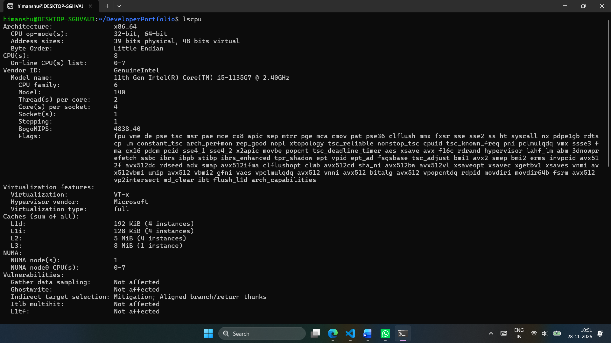
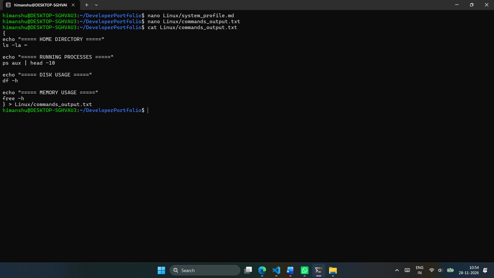
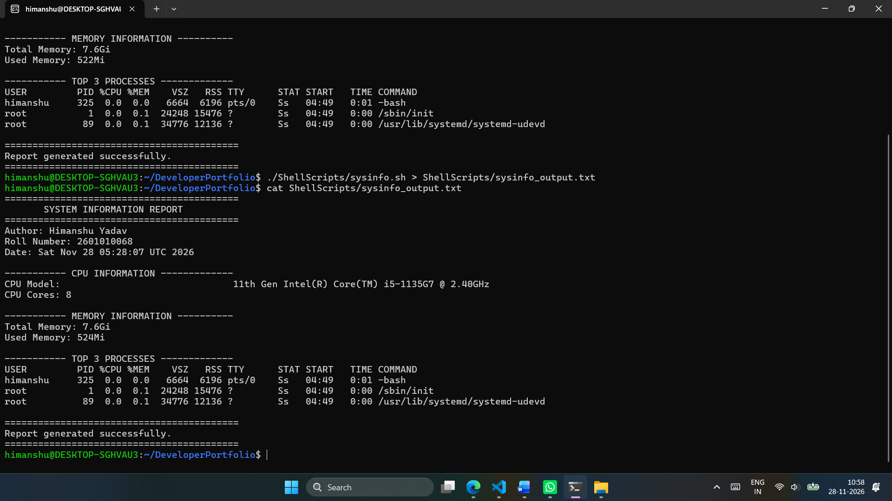
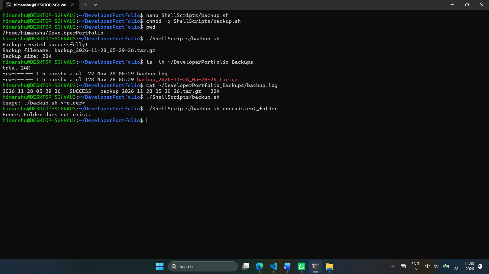
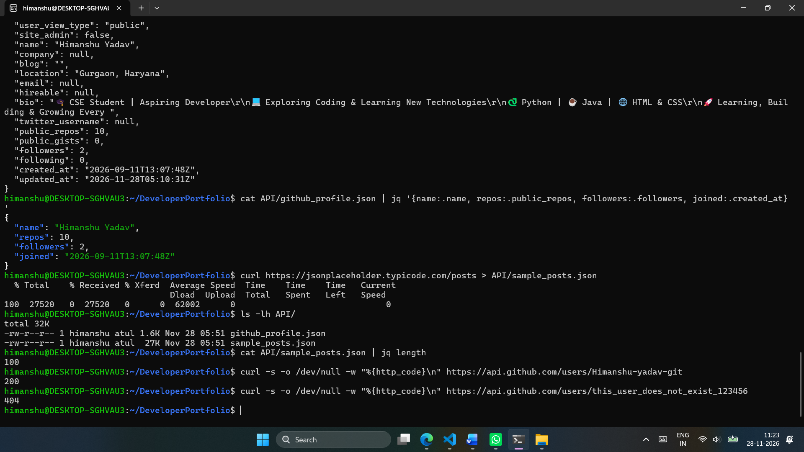
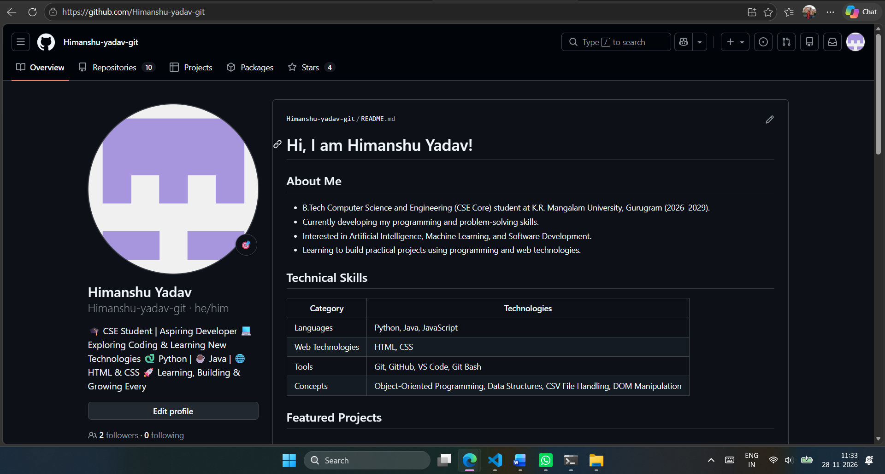
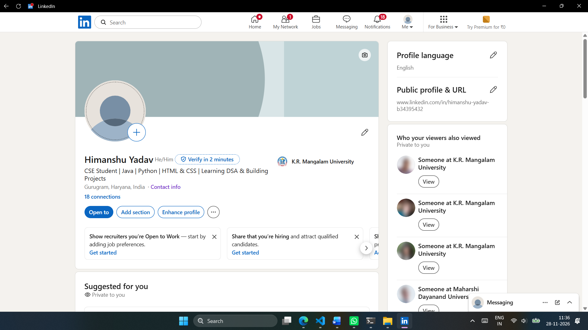
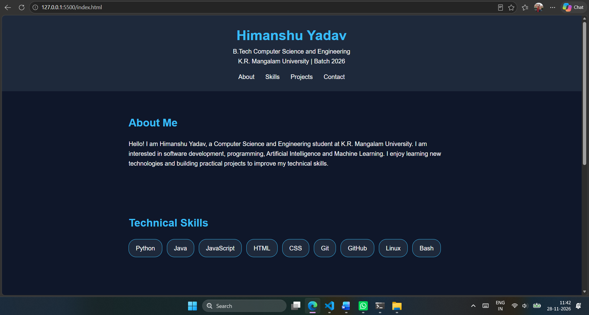
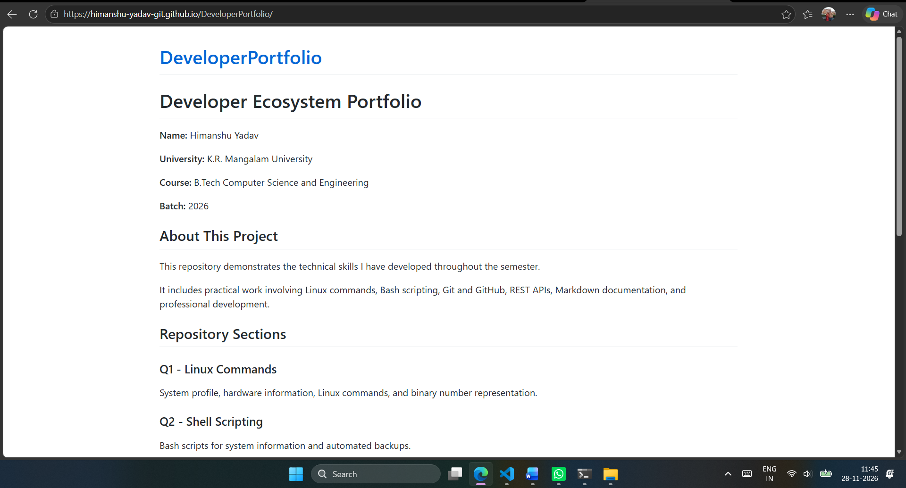

## Screenshots and Evidence

### Question 1 - Linux Commands

### Question 2 - Shell Scripting

### Question 3 - API Interaction

### Question 4 - Professional Profiles

 	

### Question 4 - Portfolio Website

## Live Website

https://Himanshu-yadav-git.github.io/DeveloperPortfolio/
